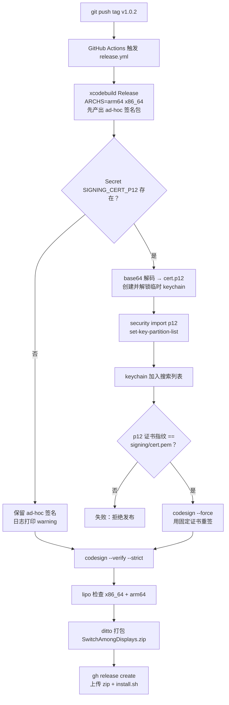
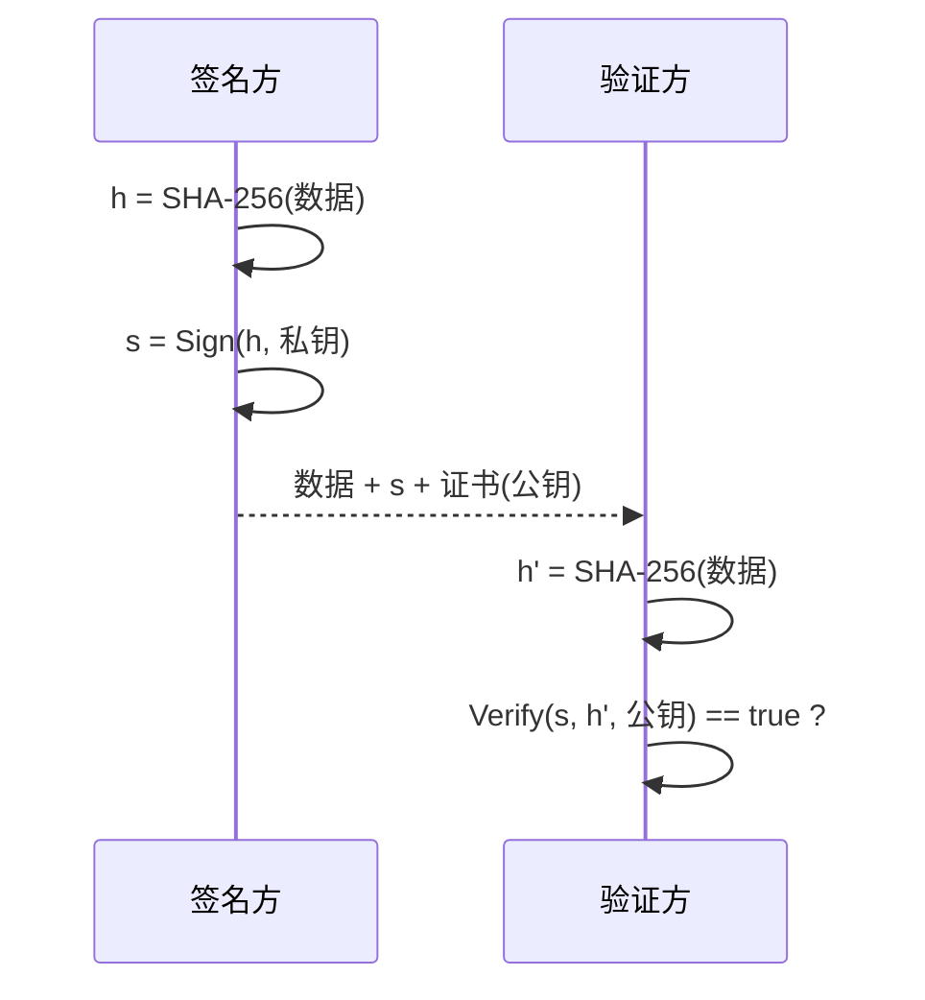
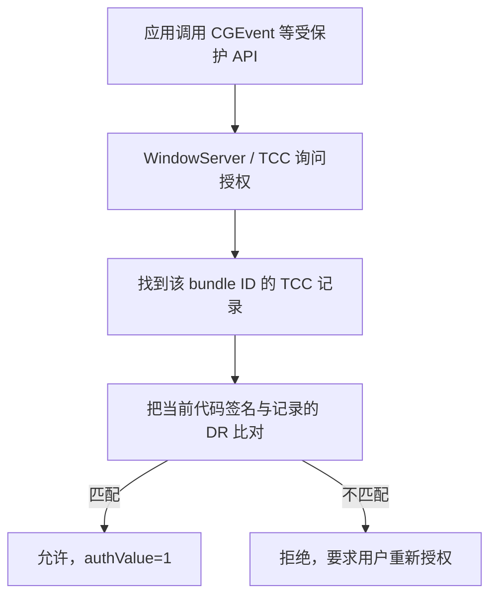

# 发布、签名与 macOS 授权

本文记录 SwitchAmongDisplays 从 `git tag` 到用户安装的完整链路，以及背后的代码签名、TCC 授权和 GitHub Actions 机制。适用于 v1.0.2 之后的版本。

## 0. 文件与角色

| 文件 / 名称 | 内容 | 是否进仓库 |
| --- | --- | --- |
| `signing/key.pem` | 私钥，签名能力的唯一来源 | 否，需离线备份 |
| `signing/cert.pem` | 自签名公钥证书 | **是** |
| `signing/cert.p12` | 证书 + 私钥，口令加密 | 否 |
| `signing/cert.p12.base64` | p12 的 base64 编码 | 否，存入 Secret |
| `signing/p12-password.txt` | p12 口令 | 否，存入 Secret |
| `SIGNING_CERT_P12` | GitHub Actions Secret | 加密保存在 GitHub |
| `SIGNING_CERT_PASSWORD` | GitHub Actions Secret | 同上 |
| `scripts/make-signing-cert.sh` | 证书生成脚本 | 是 |
| `.github/workflows/release.yml` | 发布流水线 | 是 |

核心关系：**私钥保密，公钥证书公开**。任何人拿到 `cert.pem` 都只能验证签名，不能伪造签名。

---

## 1. 发布流水线



几个容易忽略的点：

- **只有推 tag 才会触发**，推普通分支不会产生 Release。之前 `releases/latest/download/install.sh` 返回 404，就是因为一个 Release 都还没有。
- **版本号来自 tag**：`MARKETING_VERSION="${GITHUB_REF_NAME#v}"`，所以 `v1.0.2` → `1.0.2`。
- **先构建、后重签**：工程本身配置为 ad-hoc（方便本地开发和 fork），CI 拿到构建产物后用固定证书替换签名。
- **Secret 缺失时会降级为 ad-hoc 并继续发布**，只打印 warning。所以一定要先设置 Secret，再打 tag。
- `ditto -c -k --keepParent` 而不是普通 `zip`，才能保留 bundle 结构、扩展属性和签名。

---

## 2. 公钥、私钥与代码签名

### 2.1 签名不是加密

两种操作方向相反：

| 目的 | 用哪把钥匙 | 谁执行 |
| --- | --- | --- |
| 加密（保密） | 接收者的**公钥**加密，私钥解密 | 发送方 |
| 签名（认证 + 完整性） | 签名者的**私钥**签名，公钥验证 | 签名方 |

RSA 在数学上都是模幂运算，所以常被描述成“私钥加密、公钥解密”，但签名并不是为了隐藏内容——应用包本身完全公开可读。签名只证明两件事：**内容没被改过**，**签名者持有私钥**。

实际签名的是哈希，不是整个文件：



先哈希再签名有三个好处：任意长度的数据变成固定长度；签名计算量小；任何一处改动都会导致哈希完全不同。

### 2.2 证书是什么

X.509 证书本质是一段结构化数据：

- Subject（主体，如 `CN=SwitchAmongDisplays Self-Signed`）
- 公钥
- 有效期
- 序列号
- 扩展：用途、是否 CA 等
- Issuer（签发者）签名

**自签名证书**就是 Issuer = Subject，用自己的私钥给自己的公钥签名。本项目生成的证书是：

```
RSA 2048 + SHA-256，有效期 10 年
Basic Constraints: critical, CA:FALSE
Key Usage: critical, Digital Signature
Extended Key Usage: critical, Code Signing
```

证书指纹是证书 DER 字节的 SHA-1：

```bash
openssl x509 -in signing/cert.pem -noout -fingerprint -sha1
# SHA1 Fingerprint=3F:80:B3:A6:7F:B0:25:D8:1F:BD:C8:73:2D:CC:79:B7:F3:6C:3B:85
```

这个值正是 macOS 签名里的 `certificate leaf = H"3f80b3a6..."`。**TCC 记住的就是它**，不是应用路径，也不是版本号。

### 2.3 macOS 的签名结构

一个已签名 app 大致包含：

```
SwitchAmongDisplays.app/
├── Contents/MacOS/SwitchAmongDisplays      ← 可执行文件
├── Contents/Resources/...                  ← 资源
├── Contents/_CodeSignature/CodeResources   ← 资源哈希清单
└── (可执行文件内的 LC_CODE_SIGNATURE)       ← CodeDirectory + 签名
```

- **CodeDirectory**：记录可执行文件分页哈希、Info.plist、entitlements、requirements、资源清单等。
- **CodeResources**：每个资源文件的哈希。
- **CMS/PKCS#7 签名**：用私钥对 CodeDirectory 签名，并把证书一起打包。

验证时重新计算哈希，任何字节变化都会导致不匹配。**签名不会加密应用内容**，它只是一枚“防拆封条”。

`cdhash` 是 CodeDirectory 的哈希。CodeDirectory 覆盖代码页哈希、Info.plist、entitlements 以及资源哈希清单，因此**每次重新构建都会变**；ad-hoc 签名同样有 cdhash，只是没有证书。

### 2.4 designated requirement：TCC 到底在比什么

代码签名里有一段“指定要求”（designated requirement, DR），是一个谓词。常见形式：

```
# ad-hoc
identifier "com.fanloe.SwitchAmongDisplays" and cdhash H"584b78..."

# 固定自签名证书（本项目）
identifier "com.fanloe.SwitchAmongDisplays" and certificate leaf = H"3f80b3a6..."

# Developer ID（有付费账号时）
anchor apple generic and certificate 1[field.1.2.840.113635.100.6.2.6] ...
```

TCC（Transparency, Consent, and Control）数据库里存的是 bundle ID + 这段要求的序列化形式（csreq）。每次应用申请权限时：



因此：

- **ad-hoc 签名**的 DR 含 cdhash → 每次更新 cdhash 变化 → 授权失效 → 用户重新勾选。
- **固定证书**的 DR 含证书指纹 → 版本更新、cdhash 变化都不影响 → 一次授权长期有效。

这就是引入固定证书的全部原因。

查看当前 app 的 DR：

```bash
codesign -d -r- /Applications/SwitchAmongDisplays.app
```

### 2.5 自签名证书的“信任”问题

需要区分三个独立的问题：

| 问题 | 由谁回答 | 自签名证书的答案 |
| --- | --- | --- |
| 签名数学上有效吗？内容被改过吗？ | `codesign --verify` | 有效 |
| 签名者受系统信任吗？ | 信任锚 / 证书链 | **不信任**（除非手动导入信任） |
| 允许运行吗？ | Gatekeeper + quarantine | 未隔离则可运行；隔离则拦截 |

关键点：**签名和默认验证并不要求证书被系统信任**。`codesign` 的默认校验只检查签名完整性和 DR，不检查信任锚（检查信任锚需要显式选项）。信任影响的是“这个签名者是不是 Apple 认可的开发者”，不是“签名是否成立”。

这也解释了为什么 CI 上不需要把自签名证书装进信任库——我们在 runner 上实测过，未信任证书依然可以 `codesign` 签名，并且 `codesign --verify --strict` 通过。

代价是：这个证书**不是**“受信任的开发者身份”，不能公证，Gatekeeper 也不会因此放行。用户下载带 quarantine 的包时仍要手动放行；`scripts/install.sh` 用 `curl` 下载并用 `xattr` 清除隔离属性来绕过这一步。

### 2.6 PKCS#12 与口令

`cert.p12` 是把**证书 + 私钥**装进一个口令加密的容器，方便传输和导入。它保护的是私钥在静态存储时的安全，不是应用本身。

两个实践细节：

- OpenSSL 3 默认使用较新的 PKCS#12 加密算法，macOS 的 `security import` 不认，会报 `MAC verification failed`。导出时加 `-legacy`。
- 二进制不能直接放进 Secret（Secret 是文本），所以先 base64。CI 里再解码回二进制。

```bash
openssl pkcs12 -export -legacy \
  -inkey signing/key.pem -in signing/cert.pem \
  -name "SwitchAmongDisplays Self-Signed" \
  -out signing/cert.p12 -passout pass:"$PASS"
base64 -i signing/cert.p12 | tr -d '\n' > signing/cert.p12.base64
```

---

## 3. GitHub Actions 流水线

### 3.1 Secrets 如何保护私钥

GitHub Actions Secret 的存储和运行时注入本身就用了公钥密码学：

1. 每个仓库有一对密钥，**公钥**公开，用于加密你提交的 Secret（libsodium sealed box）。
2. Secret 以密文形式保存，仓库的普通读取者看不到。
3. workflow 运行时由 GitHub 解密并注入为环境变量。
4. 日志会把 Secret 原值替换成 `***`。
5. Fork 的 PR 默认拿不到 Secret；只有本仓库的 tag/branch 运行才注入。

本项目用两个 Secret：`SIGNING_CERT_P12`（base64 文本）和 `SIGNING_CERT_PASSWORD`（解密口令）。单个 Secret 上限 48 KB，我们的 base64 约 3.5 KB。

原则：**永远不要 `echo` 私钥或口令，不要 `set -x`，不要提交 `signing/` 下的机密文件**。

### 3.2 每一步在做什么

| 步骤 | 命令 | 作用 |
| --- | --- | --- |
| 建临时钥匙串 | `security create-keychain` / `unlock-keychain` | runner 是干净的，需要自己的容器 |
| 解码 | `printf '%s' "$CERT_P12" \| base64 --decode` | Secret 是文本，还原成 p12 |
| 导入 | `security import ... -T /usr/bin/codesign` | 把证书和私钥放进钥匙串，允许 codesign 使用 |
| 解锁 ACL | `security set-key-partition-list -S apple-tool:,apple:,codesign:` | 让 codesign 非交互访问私钥，避免 GUI 授权弹窗 |
| 搜索列表 | `security list-keychains -d user -s "$KEYCHAIN" ...` | 让 `codesign` 能找到这个身份 |
| 指纹校验 | `openssl x509` vs `security find-identity` | 防止 Secret 与仓库里的 `cert.pem` 不匹配 |
| 重签 | `codesign --force --options runtime --entitlements ... --sign "CN"` | 替换 xcodebuild 的 ad-hoc 签名 |
| 验证 | `codesign --verify --strict` | 签名完整、满足 DR |
| 架构检查 | `lipo -archs` | 确认 universal |
| 打包 | `ditto -c -k --keepParent` | 保留 bundle 与签名 |
| 发布 | `gh release create` | 创建 Release 并上传 zip 与 install.sh |

指纹校验用的是**不带 `-v`** 的 `find-identity`。原因见下一节。

### 3.3 为什么删掉了 `add-trusted-cert`

最初的 workflow 在导入证书后执行：

```bash
security add-trusted-cert -r trustRoot -k "$KEYCHAIN" signing/cert.pem
```

在 GitHub 托管的 macOS runner 上，这条命令会**无限期挂起**：runner 没有可交互的 GUI/SecurityAgent，命令在等待一个永远不会出现的授权弹窗。v1.0.1 的发布就卡在这里，直到超时。

修复分两部分：

1. 直接删掉这条命令——签名和验证都不需要信任锚（见 2.5）。
2. 指纹校验改用 `security find-identity -p codesigning`（不加 `-v`），因为未受信任的证书在 `-v` 模式下会被过滤掉，输出 `0 valid identities found`；不带 `-v` 时会列出身份并附带 `CSSMERR_TP_NOT_TRUSTED` 标记，仍然可用。

如果将来确实需要设置信任，务必加超时，且失败不致命：

```bash
timeout 10 security add-trusted-cert ... || echo "trust skipped"
```

macOS 自带没有 GNU `timeout`，可用 `perl -e 'alarm shift; exec @ARGV' 10 ...` 代替。

### 3.4 降级行为

`SIGNING_CERT_P12` 为空时，workflow 保留 ad-hoc 签名并打印 warning，然后照常发布。这样 fork 仓库不会因为缺少 Secret 而失败，但也意味着：**Secret 配错时发布仍会成功**。所以不能只看 Actions 是否变绿，要检查产物的 DR：

```bash
codesign -d -r- SwitchAmongDisplays.app
# 期望：certificate leaf = H"3f80b3a6..."
```

---

## 4. macOS 授权（简要）

macOS 的隐私授权由 TCC 统一管理，辅助功能（Accessibility）只是其中一项。

| 能力 | 是否需要授权 | 说明 |
| --- | --- | --- |
| 全局快捷键 | 否 | Carbon `RegisterEventHotKey` 只接收注册的那一个组合 |
| 移动光标 / 合成点击 | **是** | `CGEvent.post` 会被 WindowServer 检查 |
| 枚举显示器 | 否 | `NSScreen.screens` 不需要授权 |
| 读取所有按键 | 需要（本应用已移除） | 旧方案 `NSEvent.addGlobalMonitorForEvents` 能看到全部按键，隐私风险大 |

首次启动时应用调用 `AXIsProcessTrustedWithOptions` 弹出引导。用户勾选后，TCC 记录 DR。

调试授权问题：

```bash
# 重置本应用的辅助功能授权（应用需重启）
tccutil reset Accessibility com.fanloe.SwitchAmongDisplays

# 查看 TCC 决策日志（注意用 /usr/bin/log，zsh 有同名 builtin）
/usr/bin/log show --last 5m --predicate 'subsystem == "com.apple.TCC"' --info
```

如果日志里出现 `Failed to match existing code requirement`，说明 TCC 里存的是旧签名的要求。删除旧条目重新授权即可。

**从 ad-hoc 版本升级到固定证书版本时，需要最后一次重新授权；此后的更新不再需要。**

---

## 5. 证书生成与保管

生成（只做一次）：

```bash
./scripts/make-signing-cert.sh
```

脚本会拒绝覆盖已存在的 `signing/key.pem`，因为轮换证书会让所有已安装用户重新授权。输出文件及用途见第 0 节。

保管要求：

- `signing/key.pem` 只存在于生成它的机器上，**离线备份**（加密 U 盘、密码管理器附件等）。
- 丢失私钥 = 无法再以“同一个应用身份”签名，所有用户下次更新都要重新授权。
- 私钥泄露 = 他人可以伪造同身份签名，因此绝不能提交、上传或粘贴到聊天工具。
- 证书本身是公开的，`signing/cert.pem` 提交到仓库用于 CI 指纹校验。

---

## 6. 踩坑清单

| 现象 | 根因 | 处理 / 教训 |
| --- | --- | --- |
| `install.sh` 返回 404 | workflow 由 tag 触发，但还没有任何 Release | 先推 `v*` tag，确认 Release 已发布 |
| “已损坏，无法打开” | 浏览器下载带 `com.apple.quarantine`，且应用无 Developer ID/公证 | `xattr -dr` 或系统设置里“仍要打开”；用 `curl` 安装可避免 |
| 安装后快捷键无反应 | TCC 里存的是旧 ad-hoc 签名的 cdhash 要求 | `tccutil reset Accessibility` 后重启并重新勾选 |
| CI 卡在 Import signing certificate | `add-trusted-cert` 等 GUI 授权 | 删除该命令；签名不需要信任锚 |
| `security import` 报 MAC verification failed | OpenSSL 3 默认 p12 算法与 macOS 不兼容 | 导出时加 `-legacy` |
| `find-identity -v` 显示 0 个有效身份 | 自签名证书不在信任链里 | 用不带 `-v` 的 `find-identity`；签名本身不受影响 |
| `unsealed contents present in the bundle root` | `cp -R` 到已存在目录导致 app 嵌套 | 先删除目标目录，或用 `ditto` |
| `log show` 报参数错误 | zsh 有名为 `log` 的 builtin | 用 `/usr/bin/log` |
| 打了 tag 但发布的是 ad-hoc 包 | Secret 未设置，workflow 降级 | 先设 Secret 再打 tag；发布后检查 DR |
| 更新后授权失效 | 证书被轮换或用了 ad-hoc | 固定证书后不要轮换 |

---

## 7. 常用命令速查

```bash
# 查看 / 验证应用签名
codesign -dvvv /Applications/SwitchAmongDisplays.app
codesign -d -r- /Applications/SwitchAmongDisplays.app
codesign --verify --strict --verbose=2 /Applications/SwitchAmongDisplays.app

# 查看证书
openssl x509 -in signing/cert.pem -noout -subject -dates -fingerprint -sha1
openssl pkcs12 -legacy -in signing/cert.p12 -nokeys -clcerts \
  -passin file:signing/p12-password.txt | openssl x509 -noout -fingerprint -sha1

# 查看钥匙串身份（不加 -v 才能看到未受信任的身份）
security find-identity -p codesigning

# 重置辅助功能授权
tccutil reset Accessibility com.fanloe.SwitchAmongDisplays

# 检查隔离属性
xattr -p com.apple.quarantine /Applications/SwitchAmongDisplays.app
```

---

## 8. 其他经验

- **隐私最小化**：全局键盘监听能看到所有按键，Carbon 热键只接收注册的组合，因此前者被移除。代价是热键可配置性受 Carbon 限制。
- **点击即移动**：切换显示器时直接向目标屏幕中心投递 `CGEvent` 点击，光标移动与焦点转移一次完成；投递前清空修饰键，避免快捷键修饰键“渗透”到目标应用（例如 VS Code 误判）。
- **菜单栏应用**：`LSUIElement = YES` 隐藏 Dock 图标；关闭主窗口时 `orderOut` 而非退出。
- **无付费账号的边界**：可以自签名 + GitHub Release 分发，但无法公证，Gatekeeper 首次拦截无法根除；Homebrew cask 也因 Gatekeeper 策略逐步收紧而不可行。
- **发布前自检**：下载 CI 产物，检查 `codesign -d -r-`、`lipo -archs`、`CFBundleShortVersionString`，不要只看 Actions 是否变绿。

---

## 9. 参考资料

- Apple, [Code Signing Services](https://developer.apple.com/documentation/security/code-signing-services)
- Apple, [TN3126: Inside Code Signing: Hashes](https://developer.apple.com/documentation/technotes/tn3126-inside-code-signing-hashes)
- Apple, [TN3127: Inside Code Signing: Requirements](https://developer.apple.com/documentation/technotes/tn3127-inside-code-signing-requirements)
- GitHub Docs, [Encrypted secrets](https://docs.github.com/en/actions/security-guides/encrypted-secrets)
- CodeJam, [GitHub Action hanging on Electron macOS app code signing](https://www.codejam.info/2025/06/github-action-hanging-macos-app-code-signing.html)
- screenpipe, [CI fix: add-trusted-cert hang](https://github.com/screenpipe/screenpipe/commit/da687057e7222a08fa4b5a12f5f2a6571e78f20f)
- NoSleepLab, [AXIsProcessTrusted false after rebuild: ad-hoc signing and TCC](https://nosleeplab.com/notes/axisprocesstrusted-false-after-rebuild-ad-hoc-signing)
